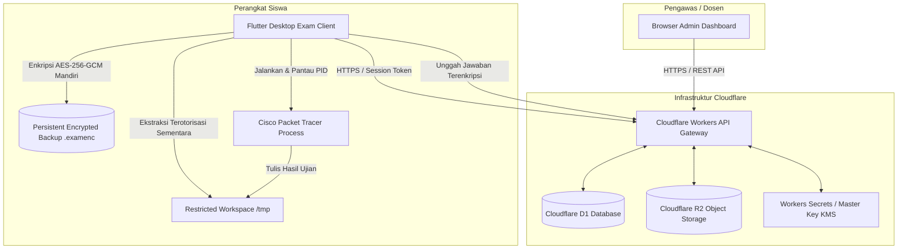
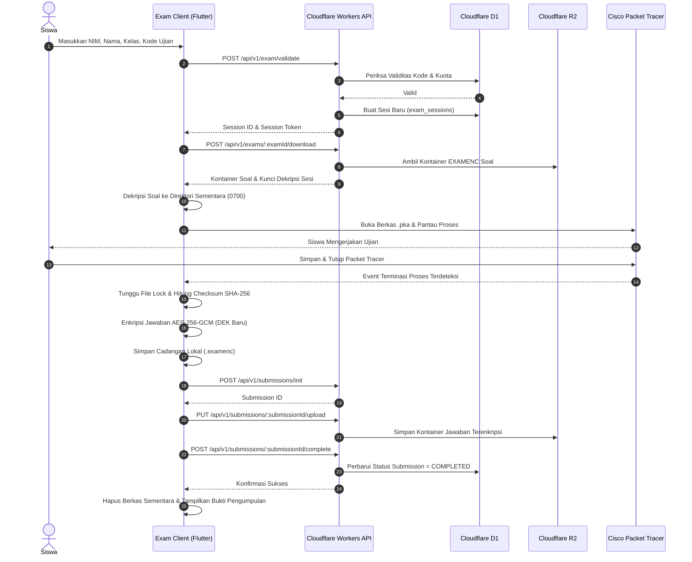

# Arsitektur Sistem Manajemen Ujian Cisco Packet Tracer

## 1. Ikhtisar Sistem

Sistem Manajemen Ujian Packet Tracer adalah platform terdistribusi yang dirancang untuk mengamankan distribusi soal ujian jaringan berbasis Cisco Packet Tracer (.pka), mengawasi proses pengerjaan siswa pada perangkat desktop (Linux, Windows, macOS), serta melakukan enkripsi dan pengunggahan otomatis jawaban siswa segera setelah aplikasi Packet Tracer ditutup.

Sistem terdiri dari tiga subsistem utama:
1. **Exam Client (Desktop Application)**: Aplikasi desktop berbasis Flutter dengan integrasi sistem operasi native untuk pemantauan proses Cisco Packet Tracer, manajemen direktori temporer berizin ketat, enkripsi jawaban lokal (.examenc), dan antrian pengunggahan latar belakang berketahanan tinggi.
2. **Backend API (Cloudflare Workers)**: Titik kontak REST API tanpa server yang menangani autentikasi kode ujian, orkestrasi sesi ujian, pembungkusan kunci enkripsi berbasis Cloudflare Workers Secrets, penyimpanan berkas terenkripsi pada Cloudflare R2, dan persistensi metadata relasional pada Cloudflare D1.
3. **Exam Management Dashboard (Web Application)**: Antarmuka administrasi berbasis web (TypeScript/React) terinspirasi antarmuka SaaS modern minimalis untuk manajemen kelas, unggah soal ujian .pka, rotasi kode ujian, pemantauan sesi, serta dekripsi dan ekspor jawaban siswa berlisensi.

## 2. Alur Kerja Siklus Hidup Ujian (Lifecycle)

### 2.1 Tahap Persiapan & Distribusi Soal (Admin)
1. Dosen membuat mata ujian pada Dashboard dan mengunggah berkas soal asli `.pka`.
2. Cloudflare Worker menghasilkan Data Encryption Key (DEK) acak 256-bit khusus untuk soal tersebut.
3. Berkas `.pka` dienkripsi dengan algoritma AES-256-GCM.
4. DEK dibungkus (wrapped) menggunakan Master Secret Key yang tersimpan aman pada Cloudflare Workers Secrets.
5. Berkas terenkripsi disimpan dalam Cloudflare R2 dalam format kontainer `EXAMENC`.
6. Metadata ujian, relasi kelas, dan kode ujian unik (exam code) dicatat ke dalam database Cloudflare D1.

### 2.2 Tahap Inisialisasi & Validasi Siswa
1. Siswa membuka Flutter Exam Client dan memasukkan NIM, Nama Lengkap, Kelas, serta Kode Ujian.
2. Exam Client memanggil endpoint `/api/v1/exam/validate`.
3. Backend memverifikasi keberadaan kode, kecocokan kelas, kuota penggunaan, dan status aktif ujian.
4. Backend menerbitkan Sesi Ujian baru (`exam_session`) beserta token otorisasi sesi jangka pendek (`session_token`).
5. Client meminta unduhan berkas soal terenkripsi melalui endpoint `/api/v1/exams/:examId/download` dengan otorisasi sesi.
6. Backend memvalidasi sesi siswa, membuka kunci DEK soal ujian, lalu mengirimkan payload terenkripsi bersama parameter dekripsi jangka pendek yang terikat sesi.

### 2.3 Tahap Eksekusi Lokal & Isolasi
1. Exam Client mendekripsi berkas `.pka` langsung di memori klien menggunakan kunci sesi yang valid.
2. Berkas `.pka` sementara ditulis ke direktori kerja terisolasi dengan hak akses ketat (posix permissions `0700` pada Linux/macOS, restricted ACL pada Windows).
3. Exam Client mendeteksi lokasi instalasi Packet Tracer lokal dan menjalankan executable Packet Tracer dengan argumen berkas `.pka` sementara.
4. Modul Process Monitor memantau PID dan status proses secara berkelanjutan.

### 2.4 Tahap Pengumpulan Otomatis & Ketahanan (Fault Tolerance)
1. Deteksi penutupan proses Packet Tracer memicu verifikasi penyelesaian penulisan berkas jawaban.
2. Exam Client menghitung checksum SHA-256 dari berkas `.pka` jawaban.
3. Kunci enkripsi baru (DEK Jawaban) dibangkitkan secara acak.
4. Berkas jawaban dienkripsi menggunakan AES-256-GCM dengan metadata terautentikasi (NIM, Session ID, Exam ID, Timestamp).
5. Cadangan lokal terenkripsi disimpan secara permanen pada direktori cadangan klien dengan ekstensi `.examenc`.
6. Client melakukan inisialisasi pengunggahan ke backend.
7. Payload terenkripsi diunggah ke backend dan disimpan ke Cloudflare R2.
8. Setelah pengunggahan diverifikasi berhasil (checksum SHA-256 dan ukuran payload valid), berkas `.pka` sementara dihapus dari sistem.
9. Jika jaringan terputus, sistem secara otomatis mengantrekan pengiriman ulang menggunakan mekanisme exponential backoff tanpa menghapus cadangan lokal `.examenc`.

## 3. Komponen Arsitektur Perangkat Lunak

### 3.1 Paket Format Kontainer Biner (`packages/exam-format`)
Paket pustaka mandiri TypeScript dan Dart yang mendefinisikan struktur biner `EXAMENC` versi 1. Pustaka ini memuat fungsi:
- `encodeContainer(header, payload, tag)`: Membentuk berkas biner kontainer standar.
- `decodeContainer(buffer)`: Membedah header biner, memvalidasi magic bytes, format version, dan mengekstrak metadata terautentikasi.
- `verifyContainerIntegrity(buffer)`: Memastikan integritas header dan tag otentikasi sebelum dilakukan operasi kriptografi.

### 3.2 Backend API (`workers/api`)
Layanan Cloudflare Workers yang dibangun secara modular:
- `src/router.ts`: Pengarah rute REST API.
- `src/controllers/`: Handler untuk modul auth, sesi, ujian, submisi, dan administrasi.
- `src/crypto/`: Operasi Web Crypto API (AES-256-GCM, PBKDF2/HKDF, SHA-256, key wrapping).
- `src/middleware/`: Pemeriksaan otorisasi berbasis Bearer Token, validasi skema masukan, audit logging, dan rate limiting.
- `migrations/`: Skema migrasi SQL untuk Cloudflare D1.

### 3.3 Exam Client Desktop (`apps/desktop`)
Aplikasi desktop Flutter dengan modularitas tingkat tinggi:
- `lib/core/crypto/`: Enkripsi/dekripsi lokal berbasis AES-256-GCM dan SHA-256.
- `lib/core/container/`: Parser dan serializer format biner `.examenc`.
- `lib/core/process/`: Pelacak proses Packet Tracer multi-platform (Linux `/proc`, Windows `EnumProcesses`, macOS `libproc` / `psep`).
- `lib/core/storage/`: Manajemen penyimpanan berkas sementara dengan izin ketat serta penyimpanan berkas cadangan lokal.
- `lib/core/network/`: Klien HTTP dengan dukungan antrian pengunggahan latar belakang dan exponential retry.
- `lib/features/`: Antarmuka layar Login, Validasi, Persiapan, Pengerjaan Aktif, Submisi, dan Pemulihan (Recovery).

### 3.4 Web Dashboard Admin (`apps/dashboard`)
Aplikasi web berbasis React dan TypeScript:
- Manajemen Mata Kuliah dan Kelas.
- Unggah berkas soal `.pka` dengan enkripsi sisi server instan.
- Generator dan rotasi kode ujian sekali pakai atau berkala.
- Pemantauan sesi aktif secara langsung.
- Tabel submisi dengan fitur dekripsi dinamis berlisensi dan ekspor arsip ZIP terdekripsi untuk penilaian dosen.
