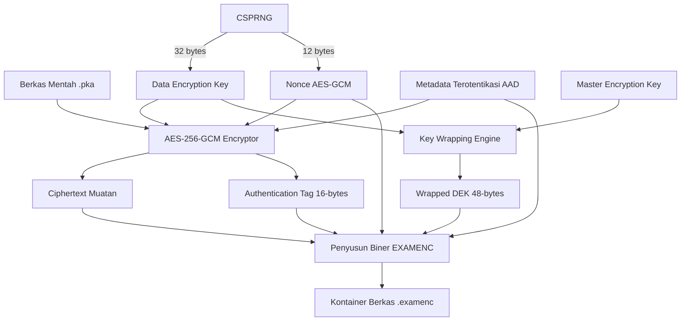

# Spesifikasi Kriptografi (Cryptography Specification)

## 1. Primitif Kriptografi Standar

Sistem secara ketat menggunakan algoritma dan primitif kriptografi standar industri yang terbukti aman. Sistem menolak penggunaan algoritma enkripsi khusus (*no custom cryptographic algorithms*):

| Kebutuhan | Algoritma / Primitif | Panjang Kunci / Blok | Parameter Standar |
| :--- | :--- | :--- | :--- |
| Enkripsi Berkas Simetris | AES-GCM | 256 bit | Nonce: 96 bit (12 bytes), Tag: 128 bit (16 bytes) |
| Derivasi Kunci | HKDF (RFC 5869) | Output: 256 bit | Hash: SHA-256, Salt acak 128 bit |
| Ringkasan Pesan (Hash) | SHA-256 | 256 bit | Standar FIPS 180-4 |
| Pembangkit Angka Acak | CSPRNG | - | `crypto.getRandomValues()` / `Random.secure()` |
| Pembungkusan Kunci (Key Wrapping) | AES-KW (RFC 3394) / AES-GCM | 256 bit | Kunci induk membungkus DEK |

## 2. Alur Enkripsi Berkas Soal Ujian (Backend)

Ketika dosen mengunggah berkas soal `.pka`:
1. **Pembangkitan Kunci Data (DEK)**:
   Backend membangkitkan `DEK` acak sepanjang 32 byte (256 bit) menggunakan CSPRNG.
2. **Pembangkitan Initialization Vector (Nonce)**:
   Backend membangkitkan `Nonce` acak sepanjang 12 byte (96 bit).
3. **Penyusunan Authenticated Data (AAD)**:
   ```json
   {
     "examId": "exam_a1b2c3d4",
     "formatVersion": 1,
     "timestamp": 1731940000,
     "purpose": "EXAM_DISTRIBUTION"
   }
   ```
4. **Enkripsi Muatan (Payload)**:
   Buffer berkas `.pka` dienkripsi menggunakan AES-256-GCM dengan `DEK`, `Nonce`, dan string JSON AAD kanonikal sebagai Associated Data.
   Operasi menghasilkan `Ciphertext` dan `Authentication Tag` (16 byte).
5. **Pembungkusan Kunci Data (Key Wrapping)**:
   `DEK` dienkripsi menggunakan `Master Encryption Key (MEK)` dari Cloudflare Workers Secret melalui AES-GCM dengan nonce wrapping khusus.
6. **Penyusunan Kontainer Biner EXAMENC**:
   Seluruh bagian dikemas ke dalam struktur biner berformat kontainer `EXAMENC`.



## 3. Alur Enkripsi dan Dekripsi Berkas Jawaban Siswa (Exam Client & Backend)

### 3.1 Pembangkitan Kunci Sesi Deterministik (HKDF-SHA256)
Agar server dapat membuka kunci jawaban mahasiswa secara terpusat tanpa menyimpan kunci sesi di memori atau mengekspos Master Key ke klien:
- Server menderivasi `SessionKey` 256-bit menggunakan **HKDF-SHA-256** dari `MasterKey` dengan `salt = sessionId` dan `info = "EXAM_SESSION_KEY"`.
- Kunci sesi ini unik untuk setiap sesi mahasiswa dan dapat direproduksi secara deterministik oleh server kapan saja hanya dengan mengetahui `sessionId`.

### 3.2 Alur Enkripsi di Klien Desktop (Saat Packet Tracer Ditutup)
1. **Pemeriksaan Integritas Berkas Lokal**:
   Klien membaca berkas `.pka` jawaban yang telah ditulis oleh Packet Tracer dan menghitung hash `SHA-256`.
2. **Pembangkitan DEK Jawaban Baru**:
   Klien membangkitkan `AnswerDEK` acak 32-byte baru dan `Nonce` acak 12-byte baru.
   Sistem tidak pernah menggunakan kembali DEK maupun Nonce dari soal ujian asli.
3. **Penyusunan AAD Jawaban**:
   ```json
   {
     "sessionId": "sess_8f9e0a1b",
     "examId": "exam_a1b2c3d4",
     "studentNim": "12345678",
     "submittedAt": 1731945000,
     "sha256Original": "e3b0c44298fc1c149afbf4c8996fb92427ae41e4649b934ca495991b7852b855"
   }
   ```
4. **Enkripsi Jawaban**:
   Buffer jawaban dienkripsi dengan AES-256-GCM menghasilkan `AnswerCiphertext` dan `AnswerTag`.
5. **Pembungkusan Kunci dengan Kunci Sesi**:
   Klien membungkus `AnswerDEK` menggunakan `SessionKey` (AES-GCM dengan nonce 12-byte).
6. **Penyimpanan Berkas Cadangan Lokal & Pengunggahan**:
   Klien menulis kontainer biner `.examenc` ke dalam folder cadangan lokal dan mengunggahnya ke Cloudflare R2 melalui backend.

### 3.3 Alur Dekripsi di Dashboard Admin (Saat Mengunduh Jawaban)
1. Server membaca kontainer biner `.examenc` dari Cloudflare R2.
2. Server mengambil `sessionId` dari header metadata kontainer biner.
3. Server menderivasi ulang `SessionKey` menggunakan HKDF-SHA256 dari `MasterKey` dan `sessionId`.
4. Server membuka kunci `AnswerDEK` menggunakan `SessionKey` (dengan fallback ke `MasterKey`).
5. Server mendekripsi muatan `.pka` menggunakan `AnswerDEK`, nonce, dan buffer metadata AAD asli (`authenticatedMetadataRaw`).
6. Berkas `.pka` asli yang siap dibuka di Cisco Packet Tracer dikirimkan langsung sebagai unduhan stream ke peramban dosen.

## 4. Keamanan Nonce dan Vektor Inisialisasi

Untuk menjamin keamanan AES-GCM:
- Nonce dibangkitkan dari CSPRNG sistem (`/dev/urandom` pada Linux/macOS, `CryptGenRandom` / `BCryptGenRandom` pada Windows).
- Panjang nonce adalah tepat 96 bit (12 byte), yang merupakan panjang standar optimal untuk menghindari overhead fungsi GHASH.
- Tidak ada nonce yang digunakan lebih dari satu kali (*nonce-reuse avoidance*). Setiap enkripsi baru wajib membangkitkan nonce segar.
