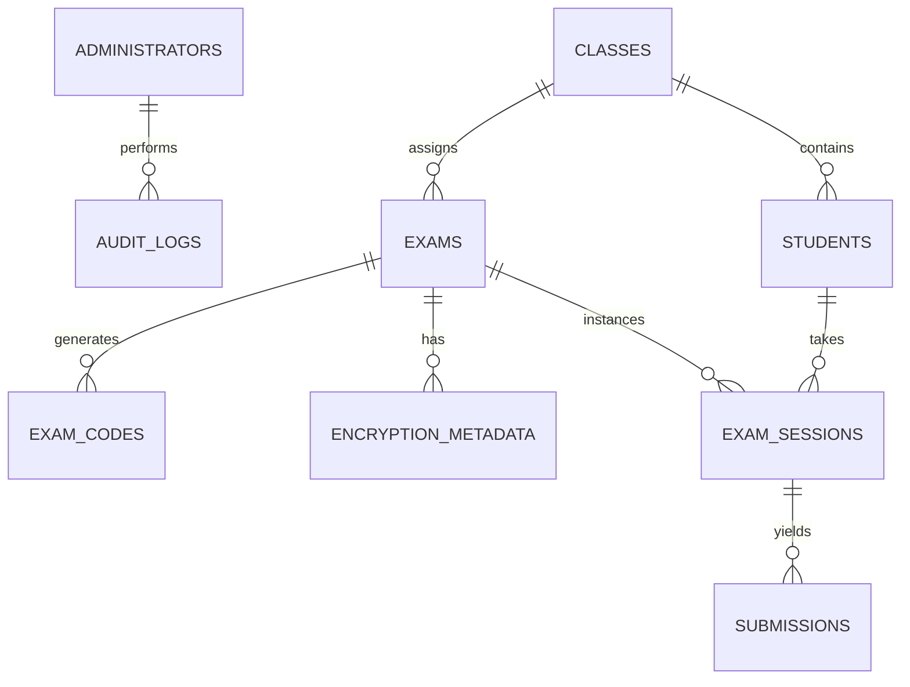

# Skema Basis Data (Cloudflare D1 Database Schema)

Basis data relasional menggunakan Cloudflare D1 (SQLite engine terdistribusi) dengan skema ternormalisasi, batasan integritas kunci asing (*foreign key constraints*), dan indeks performa.



## 1. Definisi Tabel

### 1.1 Tabel `administrators`
Menyimpan akun dosen dan pengawas sistem.
```sql
CREATE TABLE administrators (
    id TEXT PRIMARY KEY,
    username TEXT NOT NULL UNIQUE,
    email TEXT NOT NULL UNIQUE,
    password_hash TEXT NOT NULL,
    full_name TEXT NOT NULL,
    role TEXT NOT NULL DEFAULT 'LECTURER',
    created_at DATETIME NOT NULL DEFAULT CURRENT_TIMESTAMP,
    updated_at DATETIME NOT NULL DEFAULT CURRENT_TIMESTAMP
);
```

### 1.2 Tabel `classes`
Menyimpan daftar kelompok kelas perkuliahan.
```sql
CREATE TABLE classes (
    id TEXT PRIMARY KEY,
    code TEXT NOT NULL UNIQUE,
    name TEXT NOT NULL,
    academic_year TEXT NOT NULL,
    created_at DATETIME NOT NULL DEFAULT CURRENT_TIMESTAMP
);
CREATE INDEX idx_classes_code ON classes(code);
```

### 1.3 Tabel `students`
Menyimpan data identitas mahasiswa.
```sql
CREATE TABLE students (
    id TEXT PRIMARY KEY,
    nim TEXT NOT NULL UNIQUE,
    full_name TEXT NOT NULL,
    class_id TEXT NOT NULL,
    created_at DATETIME NOT NULL DEFAULT CURRENT_TIMESTAMP,
    FOREIGN KEY (class_id) REFERENCES classes(id) ON DELETE RESTRICT
);
CREATE INDEX idx_students_nim ON students(nim);
CREATE INDEX idx_students_class ON students(class_id);
```

### 1.4 Tabel `exams`
Menyimpan konfigurasi master ujian.
```sql
CREATE TABLE exams (
    id TEXT PRIMARY KEY,
    title TEXT NOT NULL,
    description TEXT,
    class_id TEXT NOT NULL,
    created_by TEXT NOT NULL,
    r2_storage_key TEXT NOT NULL,
    original_filename TEXT NOT NULL,
    duration_minutes INTEGER NOT NULL,
    is_active INTEGER NOT NULL DEFAULT 1,
    start_time DATETIME,
    end_time DATETIME,
    created_at DATETIME NOT NULL DEFAULT CURRENT_TIMESTAMP,
    updated_at DATETIME NOT NULL DEFAULT CURRENT_TIMESTAMP,
    deleted_at DATETIME,
    FOREIGN KEY (class_id) REFERENCES classes(id) ON DELETE RESTRICT,
    FOREIGN KEY (created_by) REFERENCES administrators(id) ON DELETE RESTRICT
);
CREATE INDEX idx_exams_class ON exams(class_id);
CREATE INDEX idx_exams_active ON exams(is_active);
```

### 1.5 Tabel `exam_codes`
Menyimpan kode akses ujian yang divalidasi oleh mahasiswa.
```sql
CREATE TABLE exam_codes (
    id TEXT PRIMARY KEY,
    exam_id TEXT NOT NULL,
    code TEXT NOT NULL UNIQUE,
    max_uses INTEGER NOT NULL DEFAULT 0,
    current_uses INTEGER NOT NULL DEFAULT 0,
    expires_at DATETIME,
    is_revoked INTEGER NOT NULL DEFAULT 0,
    created_at DATETIME NOT NULL DEFAULT CURRENT_TIMESTAMP,
    FOREIGN KEY (exam_id) REFERENCES exams(id) ON DELETE CASCADE
);
CREATE INDEX idx_exam_codes_lookup ON exam_codes(code, is_revoked);
```

### 1.6 Tabel `exam_sessions`
Menyimpan sesi pengerjaan ujian perorangan mahasiswa.
```sql
CREATE TABLE exam_sessions (
    id TEXT PRIMARY KEY,
    exam_id TEXT NOT NULL,
    student_id TEXT NOT NULL,
    exam_code_id TEXT NOT NULL,
    session_token_hash TEXT NOT NULL UNIQUE,
    status TEXT NOT NULL DEFAULT 'ACTIVE',
    client_ip TEXT,
    client_platform TEXT,
    started_at DATETIME NOT NULL DEFAULT CURRENT_TIMESTAMP,
    expires_at DATETIME NOT NULL,
    ended_at DATETIME,
    FOREIGN KEY (exam_id) REFERENCES exams(id) ON DELETE RESTRICT,
    FOREIGN KEY (student_id) REFERENCES students(id) ON DELETE RESTRICT,
    FOREIGN KEY (exam_code_id) REFERENCES exam_codes(id) ON DELETE RESTRICT
);
CREATE INDEX idx_sessions_token ON exam_sessions(session_token_hash);
CREATE INDEX idx_sessions_student_exam ON exam_sessions(student_id, exam_id);
```

### 1.7 Tabel `submissions`
Menyimpan catatan pengumpulan berkas jawaban terenkripsi.
```sql
CREATE TABLE submissions (
    id TEXT PRIMARY KEY,
    session_id TEXT NOT NULL UNIQUE,
    exam_id TEXT NOT NULL,
    student_id TEXT NOT NULL,
    r2_storage_key TEXT NOT NULL,
    original_sha256 TEXT NOT NULL,
    encrypted_sha256 TEXT NOT NULL,
    file_size_bytes INTEGER NOT NULL,
    status TEXT NOT NULL DEFAULT 'PENDING',
    retry_count INTEGER NOT NULL DEFAULT 0,
    created_at DATETIME NOT NULL DEFAULT CURRENT_TIMESTAMP,
    completed_at DATETIME,
    FOREIGN KEY (session_id) REFERENCES exam_sessions(id) ON DELETE RESTRICT,
    FOREIGN KEY (exam_id) REFERENCES exams(id) ON DELETE RESTRICT,
    FOREIGN KEY (student_id) REFERENCES students(id) ON DELETE RESTRICT
);
CREATE INDEX idx_submissions_status ON submissions(status);
CREATE INDEX idx_submissions_exam ON submissions(exam_id);
```

### 1.8 Tabel `encryption_metadata`
Menyimpan parameter kriptografi publik untuk kontainer soal dan kunci terbungkus.
```sql
CREATE TABLE encryption_metadata (
    id TEXT PRIMARY KEY,
    resource_id TEXT NOT NULL UNIQUE,
    resource_type TEXT NOT NULL,
    format_version INTEGER NOT NULL DEFAULT 1,
    algorithm TEXT NOT NULL DEFAULT 'AES-256-GCM',
    key_identifier TEXT NOT NULL,
    nonce_hex TEXT NOT NULL,
    wrapped_dek_hex TEXT NOT NULL,
    original_file_size INTEGER NOT NULL,
    auth_tag_hex TEXT NOT NULL,
    created_at DATETIME NOT NULL DEFAULT CURRENT_TIMESTAMP
);
CREATE INDEX idx_crypto_resource ON encryption_metadata(resource_id, resource_type);
```

### 1.9 Tabel `audit_logs`
Menyimpan jejak audit sistem keamanan yang tidak dapat diubah (*append-only*).
```sql
CREATE TABLE audit_logs (
    id TEXT PRIMARY KEY,
    actor_id TEXT NOT NULL,
    actor_type TEXT NOT NULL,
    action TEXT NOT NULL,
    target_resource TEXT NOT NULL,
    details_json TEXT,
    ip_address TEXT,
    created_at DATETIME NOT NULL DEFAULT CURRENT_TIMESTAMP
);
CREATE INDEX idx_audit_created ON audit_logs(created_at);
```
