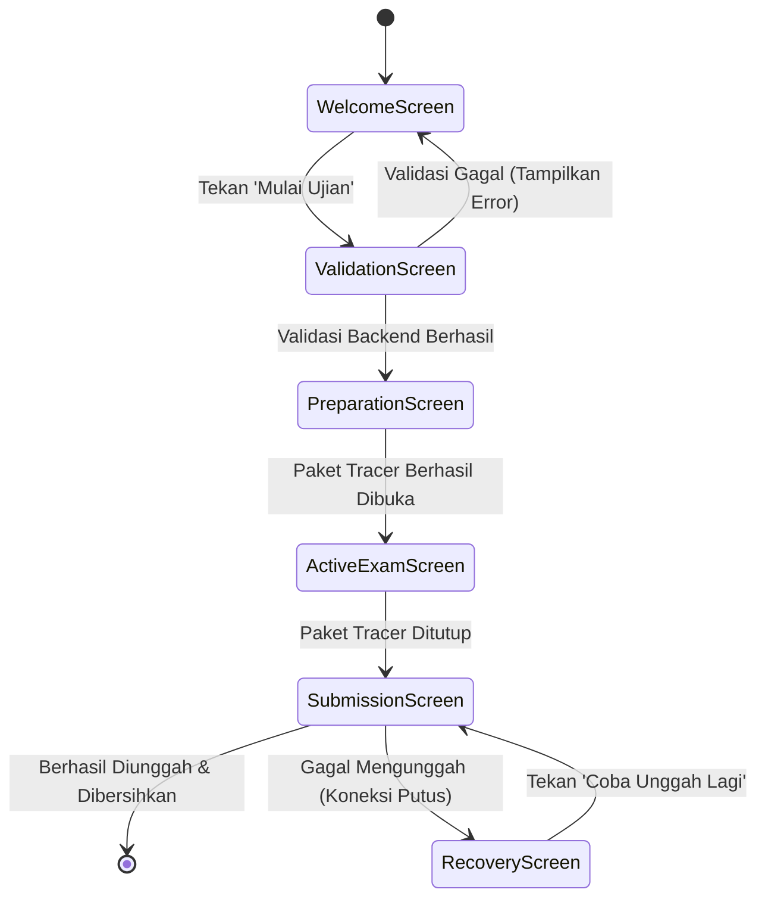

# Integrasi Klien Desktop (Flutter Desktop Client Architecture)

## 1. Arsitektur Desain Antarmuka (GNOME-Inspired UI)

Aplikasi desktop mahasiswa dibangun dengan arsitektur UI berbasis GNOME Human Interface Guidelines (HIG):
- **Palet Warna**: Latar belakang Dark Slate (`#1E1E2E` / `#24283B`), teks kontras tinggi, aksen Coral/Pink (`#F7768E` / `#FF757F`), dan indikator status Cyan/Green (`#73DACA`).
- **Komponen**: Rounded Card (radius 12-16px), border halus 1px (`rgba(255,255,255,0.08)`), tanpa animasi berlebihan, tipografi proporsional (Inter / Cantarell / Roboto).
- **Pengalaman Pengguna**: Alur kerja berbasis tahapan (*stepped wizard workflow*) yang jelas dan responsif terhadap status sistem.

## 2. Struktur Layar dan Alur Interaksi

### 2.1 Layar Selamat Datang (Welcome Screen)
- Form identifikasi mahasiswa:
  - Input NIM (validasi angka/format kampus).
  - Input Nama Lengkap Mahasiswa.
  - Pilihan Kelompok Kelas.
  - Input Kode Ujian (Exam Code).
- Tombol validasi utama dengan verifikasi masukan non-kosong.

### 2.2 Layar Validasi (Validation Screen)
- Melakukan verifikasi backend secara asinkron.
- Menampilkan indikator loading melingkar (GNOME Spinner) dengan status teks:
  - "Menghubungi peladen ujian..."
  - "Memverifikasi kode ujian dan kuota kelas..."
  - "Menginisialisasi sesi ujian aman..."

### 2.3 Layar Persiapan & Unduh (Preparation Screen)
- Menampilkan rincian ujian: Judul Ujian, Waktu Pengerjaan, dan Status Instalasi Packet Tracer.
- Mengunduh paket kontainer soal ujian terenkripsi.
- Menjalankan dekripsi lokal ke workspace sementara dengan izin 0700.
- Tombol "Buka Cisco Packet Tracer" dengan deteksi jalur eksekutabel otomatis.

### 2.4 Layar Pengerjaan Aktif (Active Exam Screen)
- Tampilan kartu ringkas status ujian aktif.
- Menampilkan waktu hitung mundur sisa durasi ujian.
- Indikator deteksi proses: PID Packet Tracer yang sedang berjalan.
- Pesan petunjuk: "Kerjakan ujian pada jendela Cisco Packet Tracer. Simpan pekerjaan Anda secara berkala (Ctrl+S). Tutup aplikasi Packet Tracer setelah selesai untuk mengumpulkan jawaban otomatis."

### 2.5 Layar Submisi (Submission Screen)
- Dipicu segera saat proses Packet Tracer ditutup.
- Menjalankan urutan otomatis:
  1. Verifikasi selesainya penulisan berkas.
  2. Perhitungan Checksum SHA-256.
  3. Enkripsi jawaban AES-256-GCM.
  4. Penyimpanan cadangan lokal `.examenc`.
  5. Pengunggahan berkas ke Cloudflare R2 melalui backend.
  6. Pembersihan berkas plaintext `.pka`.
- Menampilkan konfirmasi tanda terima digital: ID Submisi, Waktu Pengumpulan, dan Hash SHA-256.

### 2.6 Layar Pemulihan (Recovery Screen)
- Menampilkan daftar berkas cadangan lokal `.examenc` yang belum berhasil terunggah (status pending/failed).
- Tombol aksi: "Coba Unggah Sekarang" dengan verifikasi integritas instan sebelum retry.
- Informasi diagnostik error terakhir (misal: "Koneksi timeout").
