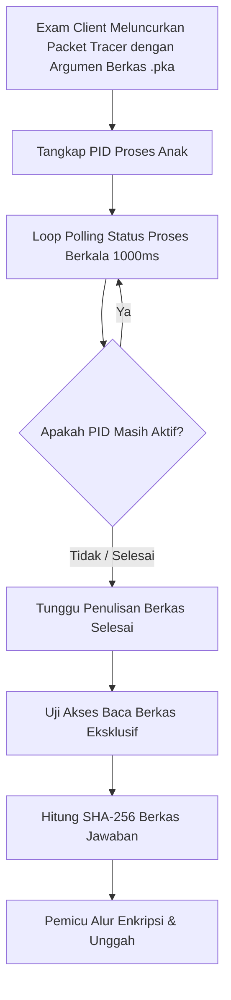

# Strategi Integrasi Cisco Packet Tracer Lintas Platform

## 1. Lokasi Standar Instalasi Packet Tracer

Aplikasi pendeteksi menginspeksi direktori standar berdasarkan sistem operasi sebelum meminta masukan manual jika eksekutabel tidak ditemukan:

### 1.1 Linux
- Jalur biner utama:
  - `/opt/pt/packettracer.AppImage` (Packet Tracer 9.0+)
  - `/opt/pt/bin/PacketTracer`
  - `/opt/pt/bin/packettracer`
  - `/usr/local/bin/packettracer`
  - `/usr/bin/packettracer`
  - `/usr/bin/PacketTracer`
  - `~/.local/share/cisco/packettracer/bin/PacketTracer`
- Deteksi via `which packettracer`, `which PacketTracer`, atau `which cisco-packet-tracer`.
- **Deteksi Asosiasi Berkas (MIME Association Handler)**:
  Jika jalur standar tidak ditemukan, sistem memanfaatkan `xdg-mime` atau `gio` untuk mencari aplikasi default pembuka ekstensi `.pka` / `.pkt` (`application/x-pka` dan `application/x-pkt`):
  1. `xdg-mime query default application/x-pka`
  2. `gio mime application/x-pka`
  3. Membaca berkas `.desktop` terkait di `~/.local/share/applications/` atau `/usr/share/applications/`.
  4. Mengekstrak perintah eksekusi dari baris `Exec=`.
  5. Memindai entri desktop yang mengandung metadata `application/x-pka` atau nama Packet Tracer.

### 1.2 Microsoft Windows
- Lokasi program umum (64-bit & 32-bit):
  - `C:\Program Files\Cisco Packet Tracer 9.0.1\bin\PacketTracer.exe`
  - `C:\Program Files\Cisco Packet Tracer 9.0.0\bin\PacketTracer.exe`
  - `C:\Program Files\Cisco Packet Tracer 8.2.2\bin\PacketTracer.exe`
  - `C:\Program Files\Cisco Packet Tracer 8.2.1\bin\PacketTracer.exe`
  - `C:\Program Files\Cisco Packet Tracer 8.2.0\bin\PacketTracer.exe`
  - `C:\Program Files\Cisco Packet Tracer 8.1.1\bin\PacketTracer.exe`
  - `C:\Program Files\Cisco Packet Tracer 8.0\bin\PacketTracer.exe`
  - `C:\Program Files (x86)\Cisco Packet Tracer\bin\PacketTracer.exe`
- **Deteksi Asosiasi Berkas Windows**:
  1. Menjalankan `cmd.exe /c assoc .pka` dan `assoc .pkt` untuk mendapatkan ProgID (misal: `PacketTracer.pka`).
  2. Menjalankan `cmd.exe /c ftype <ProgID>` untuk mengekstrak jalur absolut executable.
  3. Menginspeksi Windows Registry via PowerShell pada `HKLM\SOFTWARE\Microsoft\Windows\CurrentVersion\App Paths\PacketTracer.exe` atau `HKCR\.pka`.

### 1.3 Apple macOS
- Berkas Application Bundle:
  - `/Applications/Cisco Packet Tracer.app/Contents/MacOS/PacketTracer`
  - `/Applications/Cisco Packet Tracer 9.0.1/Cisco Packet Tracer.app/Contents/MacOS/PacketTracer`
  - `/Applications/Cisco Packet Tracer 8.2.2/Cisco Packet Tracer.app/Contents/MacOS/PacketTracer`
  - `~/Applications/Cisco Packet Tracer.app/Contents/MacOS/PacketTracer`
- **Deteksi Asosiasi Berkas macOS**:
  1. Menjalankan kueri AppleScript: `osascript -e 'set appPath to POSIX path of (path to application "Cisco Packet Tracer")'`.
  2. Menjalankan kueri Spotlight: `mdfind 'kMDItemFSName == "PacketTracer" || kMDItemFSName == "Cisco Packet Tracer.app"'`.
  3. Mengekstrak biner internal bundel di `Contents/MacOS/PacketTracer`.

### 1.4 Fallback Penentuan Jalur Manual (UI Override)
Jika seluruh metode otomatis di atas tidak menemukan eksekutabel karena konfigurasi sistem yang sangat khusus (misal: disimpan di folder non-standar atau partisi terpisah), antarmuka klien desktop menyediakan tombol **Tentukan Lokasi Packet Tracer Manual** pada layar persiapan. Mahasiswa dapat memasukkan jalur executable secara langsung, dan sistem akan memvalidasi izin eksekusi berkas tersebut sebelum memulai ujian.

---

## 2. Strategi Pemantauan Proses (Process Monitoring Strategy)

Sistem tidak hanya mengandalkan nama eksekutabel generik, melainkan mengikat pemantauan dengan *Process Identifier (PID)* sesi eksekusi yang diluncurkan oleh Exam Client.

### 2.1 Pemantauan pada Linux
1. **Identifikasi Proses**:
   Saat mengeksekusi `Process.start()`, Dart menangkap `process.pid`.
2. **Inspeksi `/proc`**:
   Status proses diverifikasi dengan memeriksa keberadaan direktori `/proc/<pid>/`.
   Untuk memverifikasi bahwa PID tersebut benar-benar Packet Tracer (bukan PID daur ulang), klien membaca `/proc/<pid>/cmdline` dan `/proc/<pid>/comm`.
3. **Deteksi Terminasi**:
   Kombinasi pendengar stream `process.exitCode` dan inspeksi `/proc/<pid>/status`.

### 2.2 Pemantauan pada Windows
1. **Identifikasi Proses**:
   Menangkap `process.pid` saat `Process.start()`.
2. **Native Handle / Polling**:
   Memeriksa ketersediaan PID melalui utilitas sistem bawaan `tasklist /FI "PID eq <pid>"` atau perintah PowerShell `Get-Process -Id <pid>` jika FFI tidak tersedia.
3. **Deteksi Terminasi**:
   Menangkap sinyal `exitCode` proses anak secara deterministik.

### 2.3 Pemantauan pada macOS
1. **Identifikasi Proses**:
   Menjalankan biner bundel secara langsung untuk mempertahankan kontrol proses anak.
2. **Pemeriksaan Status**:
   Inspeksi via `kill -0 <pid>` atau `ps -p <pid>`.
3. **Deteksi Terminasi**:
   Menunggu penutupan jendela dan sinyal keluar proses.

---

## 3. Deteksi Penyelesaian Penulisan Berkas (File-Write Settling)

Ketika Packet Tracer ditutup, sistem operasi atau aplikasi terkadang masih menyelesaikan flushing buffer disk untuk berkas `.pka`.
Sistem menerapkan algoritma verifikasi kesiapan berkas (*settling check*):
1. Menunggu jeda awal 500 milidetik setelah proses berakhir.
2. Membaca ukuran berkas fisik pada waktu $t_0$.
3. Menunggu 250 milidetik dan membaca ukuran berkas pada waktu $t_1$.
4. Membuka stream bacaan berkas dengan mode eksklusif. Jika sistem operasi menolak dengan pesan *File is locked by another process*, klien melakukan polling ulang maksimal 10 kali (total batas waktu 5 detik).
5. Memverifikasi ukuran berkas $> 0$ byte.
6. Menghitung ringkasan SHA-256 untuk memastikan berkas dapat dibaca secara utuh tanpa I/O Exception.
