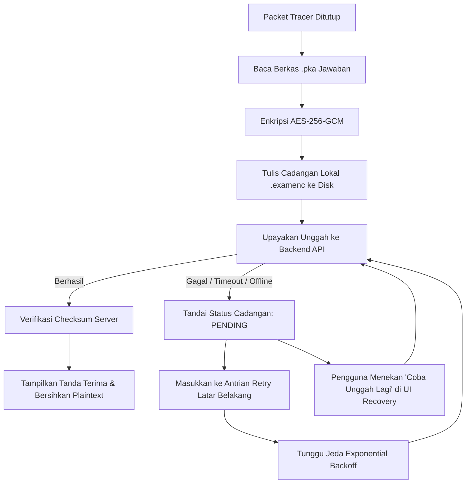

# Prosedur Pemulihan dan Ketahanan Sistem (Recovery & Fault Tolerance)

## 1. Prinsip Pemulihan Tanpa Pengulangan Ujian

Salah satu persyaratan kritis sistem adalah: **Siswa tidak boleh dipaksa mengulang ujian jika terjadi kegagalan jaringan, laptop mati mendadak, atau aplikasi tertutup saat pengunggahan.**

Seluruh jawaban yang telah dikerjakan oleh siswa dijamin keselamatannya melalui mekanisme persistensi bertingkat (*multi-layer persistence*).

---

## 2. Struktur Cadangan Lokal (Encrypted Local Backup)

Setiap kali Packet Tracer ditutup, berkas jawaban dienkripsi dan disimpan di direktori khusus:
- **Linux**: `~/.local/share/packet_tracer_exam/backups/`
- **Windows**: `%LOCALAPPDATA%\PacketTracerExam\Backups\`
- **macOS**: `~/Library/Application Support/PacketTracerExam/Backups/`

### 2.1 Konvensi Penamaan Berkas Cadangan
Berkas cadangan menggunakan nama berformat:
`<examId>_<studentNim>_<sessionId>.examenc`

Contoh: `exam_7718293041_210001001_sess_8f9e0a1b.examenc`

### 2.2 Metadata Keutuhan Cadangan
Setiap berkas `.examenc` memuat metadata terotentikasi di dalam kontainer biner:
- ID Sesi Mahasiswa
- ID Ujian
- NIM Mahasiswa
- Waktu Penyimpanan Lokal (Epoch Milliseconds)
- Checksum SHA-256 berkas `.pka` asli sebelum dienkripsi

---

## 3. Skenario Kegagalan dan Langkah Mitigasi

### 3.1 Kegagalan Koneksi Internet Saat Pengunggahan
- Klien mendeteksi kegagalan jaringan (SocketException / NetworkTimeout).
- Berkas cadangan lokal tetap utuh dan berstatus `PENDING_UPLOAD`.
- Klien memulai timer pengiriman ulang berbasis *exponential backoff*:
  - Percobaan 1: Jeda 5 detik
  - Percobaan 2: Jeda 15 detik
  - Percobaan 3: Jeda 45 detik
  - Percobaan 4: Jeda 120 detik
- Antarmuka menampilkan tombol manual "Coba Unggah Lagi" sehingga mahasiswa atau pengawas dapat memicu sinkronisasi manual saat koneksi kembali stabil.

### 3.2 Laptop Mahasiswa Mati Mendadak (Baterai Habis / Crash)
- Setelah laptop dihidupkan kembali, mahasiswa membuka aplikasi Exam Client.
- Pada saat inisialisasi, klien memindai folder cadangan lokal.
- Jika ditemukan berkas `.examenc` berstatus belum terunggah, klien langsung membuka **Recovery Screen**.
- Mahasiswa mengklik "Coba Unggah Sekarang". Klien memvalidasi integritas kontainer biner sebelum mengirimkannya ke endpoint `/api/v1/submissions/sub_.../upload`.
- Mahasiswa tidak perlu mengulang ujian dari awal.

### 3.3 Packet Tracer Mengalami Crash Selama Pengerjaan
- Exam Client mendeteksi bahwa proses Packet Tracer berhenti secara tidak normal (exit code bukan 0 atau terminasi tak terduga).
- Klien memeriksa apakah berkas sementara `.pka` pada workspace terisolasi masih ada dan memiliki ukuran $> 0$.
- Klien menawarkan opsi:
  - Buka kembali Packet Tracer dengan berkas pengerjaan terakhir yang tersimpan.
  - Selesaikan dan kumpulkan kondisi pengerjaan terakhir yang ada saat ini.

---

## 4. Ekspor Cadangan Manual oleh Pengawas

Jika jaringan ruang ujian mengalami pemadaman total:
1. Pengawas dapat mengarahkan aplikasi ke mode bantuan pengawas.
2. Berkas `.examenc` dari folder cadangan lokal dapat disalin ke flashdisk oleh pengawas.
3. Karena berkas biner `.examenc` terenkripsi dengan AES-256-GCM, berkas tersebut aman dibawa tanpa risiko kebocoran isi jawaban.
4. Pengawas dapat mengunggah berkas `.examenc` tersebut langsung melalui antarmuka Web Admin Dashboard pada menu "Batch Ingest Submissions".
